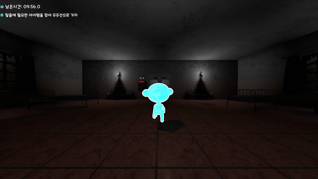
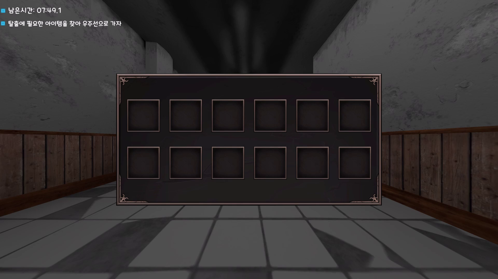

# Zelo, Way Back Home · 3D 방탈출
> 제한 시간 안에 공간을 탐색하고 아이템과 퍼즐을 이용해 탈출하는 3D 게임.

[Unity 프로젝트 보기](https://github.com/snsn8105/CGTeam2/tree/main/Team2%20Project)

## 플레이 영상 · 스크린샷

[전체 플레이 영상 · MP4](https://github.com/snsn8105/CGTeam2/blob/main/docs/media/gameplay.mp4) · [다운로드](https://github.com/snsn8105/CGTeam2/raw/refs/heads/main/docs/media/gameplay.mp4) · 1080p / 30fps

스크린샷 보기

## 게임 소개
3D 공간에서 단서를 찾고 아이템을 수집하며 비밀번호 퍼즐과 탈출 장치를 해결합니다. 제한 시간 안에 탈출 조건을 달성하면 성공하고, 시간이 소진되면 실패합니다.

## 주요 특징
- 3D 공간 탐색과 오브젝트 상호작용
- 아이템 획득 및 인벤토리
- 키패드 비밀번호 퍼즐과 문 상호작용
- 에너지 셀·발사 장치를 이용한 탈출
- 제한 시간과 성공·실패 결과 씬

## 개발 정보
| 항목 | 내용 |
| --- | --- |
| 개발 형태 | 팀 프로젝트 |
| 개발 환경 | Unity 2021.3.30f1, C# |
| 사용 기술 | Unity 3D, CharacterController, Physics.SphereCast, TextMeshPro |
| 담당 역할 | 탈출 로직 설계 및 구현 |

## 조작 방법
상호작용 대상에 따라 화면의 안내를 확인합니다.

| 입력 | 기능 |
| --- | --- |
| W / A / S / D | 이동 |
| Left Shift | 달리기 |
| E | 아이템 획득 및 장치 상호작용 |
| G | 키패드 및 문 상호작용 |
| I | 인벤토리 열기·닫기 |
| F | 아이템 안내 닫기 |

## 실행 방법
1. 저장소를 내려받습니다.
2. Unity Hub에서 저장소 내부의 **`Team2 Project` 폴더**를 프로젝트로 추가합니다.
3. **Unity 2021.3.30f1**로 열고 패키지와 에셋 임포트를 기다립니다.
4. Build Settings에 등록된 `Title` 씬을 열어 실행합니다.

외부 캐릭터·환경·셰이더 등 에셋의 권리는 각 제작자에게 있습니다.

